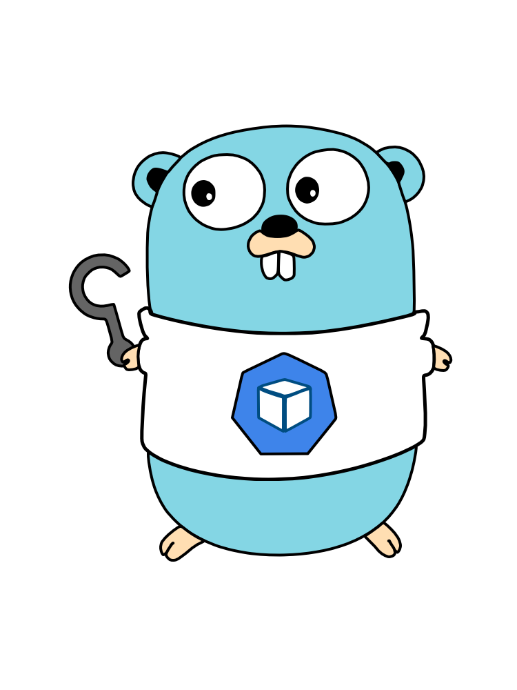
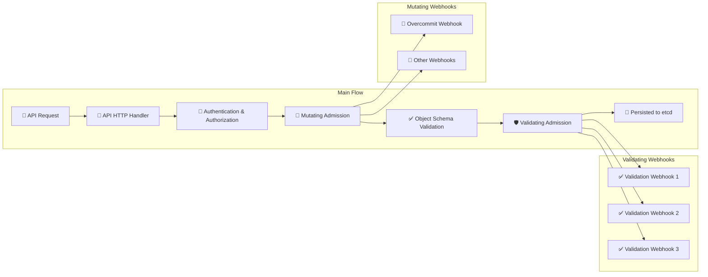

<!--
SPDX-FileCopyrightText: 2025 2025 INDUSTRIA DE DISEÑO TEXTIL S.A. (INDITEX S.A.)
SPDX-FileContributor: enriqueavi@inditex.com

SPDX-License-Identifier: CC-BY-4.0
-->

<div align="center">

# 🚀 k8s-overcommit Operator

**Intelligent resource overcommit management for Kubernetes clusters**

[](LICENSE)
[](https://github.com/InditexTech/k8s-overcommit-operator/releases)
[](go.mod)
[](https://github.com/InditexTech/k8s-overcommit-operator/actions)

[](https://kubernetes.io/)
[](https://sdk.operatorframework.io/)
[](https://golang.org/)
[](https://helm.sh/)
[](https://reuse.software/)

[](https://github.com/InditexTech/k8s-overcommit-operator/issues)
[](https://github.com/InditexTech/k8s-overcommit-operator/pulls)
[](https://github.com/InditexTech/k8s-overcommit-operator/stargazers)
[](https://github.com/InditexTech/k8s-overcommit-operator/network/members)

[🚀 Quick Start](#-quick-start) • [📖 Documentation](./docs) • [🤝 Contributing](./CONTRIBUTING.md) • [📝 License](./LICENSE)



</div>

---

## 🎯 Overview

The **k8s-overcommit Operator** is a Kubernetes operator designed to intelligently manage resource overcommit on pod resource requests. It automatically adjusts CPU and memory requests based on configurable overcommit classes, enabling better cluster resource utilization while maintaining workload performance.

### ✨ Key Features

- 🎛️ **Flexible Overcommit Classes**: Define different overcommit policies for different workload types
- 🏷️ **Label-Based Configuration**: Apply overcommit using pod or namespace labels
- 🛡️ **Namespace Exclusions**: Protect critical namespaces from overcommit policies
- 📊 **Default Policies**: Fallback overcommit values when no specific class is defined
- 🔒 **Admission Webhooks**: Seamless integration with Kubernetes admission controllers
- 📈 **Resource Optimization**: Improve cluster resource utilization efficiency

---

## 📦 Where to find it

The operator is published in the community OLM catalogs, so it can be installed without
cloning this repository:

| Catalog | Where it is available | Package | Channels |
|---------|----------------------|---------|----------|
| [OperatorHub.io](https://operatorhub.io/operator/k8s-overcommit) | Any Kubernetes cluster running OLM | `k8s-overcommit` | `stable` (default), `alpha` |
| [OpenShift community operators](https://github.com/redhat-openshift-ecosystem/community-operators-prod) | OpenShift 4.15 and later, through the embedded OperatorHub | `k8s-overcommit` | `stable` (default), `alpha` |
| [Project catalog](./deploy/catalog_source.yaml) | Any Kubernetes cluster running OLM, catalog published from this repository | `k8s-overcommit` | `stable` (default), `alpha` |

On a disconnected cluster, mirror the catalog image into your own registry before
installing; the operator image and cert-manager have to be mirrored as well.

---

## 🚀 Quick Start

### 🎯 Method 1: Helm Installation (Recommended)

#### 1️⃣ Clone the Repository

Clone the repository to your local machine:

```bash
git clone https://github.com/InditexTech/k8s-overcommit-operator.git
cd k8s-overcommit-operator
```

#### 2️⃣ Configure Values

Edit the [`values.yaml`](../chart/values.yaml) file to customize your deployment. Below is an example configuration:

```yaml
# Example configuration
deployment:
  image:
    registry: ghcr.io
    image: inditextech/k8s-overcommit-operator
    tag: 1.3.6
```

#### 3️⃣ Install with Helm

Install the operator using Helm:

```bash
helm install k8s-overcommit-operator chart
```

### 🔧 Method 2: OLM Installation

#### Option A: From the community catalogs (recommended)

The operator is published in the community OLM catalogs, so there is nothing to clone: on
OpenShift 4.15 or later it is part of the embedded OperatorHub, and on upstream OLM
clusters it comes from OperatorHub.io.

Create the Subscription:

```yaml
apiVersion: operators.coreos.com/v1alpha1
kind: Subscription
metadata:
  name: k8s-overcommit
  namespace: openshift-operators
spec:
  channel: stable
  name: k8s-overcommit
  source: community-operators
  sourceNamespace: openshift-marketplace
```

`community-operators` in `openshift-marketplace` is the OpenShift catalog. On clusters that
consume OperatorHub.io instead, use `source: operatorhubio-catalog` and
`sourceNamespace: olm`. In the web console it is the same thing through
**Operators → OperatorHub**, searching for "K8s Overcommit".

#### Option B: From this repository's own catalog

Use this when you want the catalog published by this project instead of the community one.

**1. Install the CatalogSource**

```bash
kubectl apply -f https://raw.githubusercontent.com/InditexTech/k8s-overcommit-operator/refs/heads/main/deploy/catalog_source.yaml
```

**2. Apply the OperatorGroup**

```bash
kubectl apply -f https://raw.githubusercontent.com/InditexTech/k8s-overcommit-operator/refs/heads/main/deploy/operator_group.yaml
```

**3. Create the Subscription**

The repository ships a working Subscription in
[`deploy/subscription.yaml`](../deploy/subscription.yaml); apply it with:

```bash
kubectl apply -f https://raw.githubusercontent.com/InditexTech/k8s-overcommit-operator/refs/heads/main/deploy/subscription.yaml
```

#### Validation

After installation, check that the CSV reached `Succeeded` and that the operator pod is
running (the namespace is `openshift-operators` with Option A and `k8s-overcommit` with
Option B):

```bash
kubectl get csv -A | grep k8s-overcommit
kubectl get pods -A | grep k8s-overcommit
```


## 📝 Configuration

### 🎯 Overcommit Resource

> [!IMPORTANT]
> **It's a singleton CRD**: only can exist one, and it has to be called **cluster**

First, deploy the main `Overcommit` resource named **"cluster"**:

```yaml
apiVersion: overcommit.inditex.dev/v1alphav1
kind: Overcommit
metadata:
  name: cluster
spec:
  overcommitLabel: inditex.com/overcommit-class
  labels:
    environment: production
  annotations:
    description: "Main overcommit configuration"
```

### 🏷️ OvercommitClass Resource

Define overcommit classes for different workload types:

```yaml
apiVersion: overcommit.inditex.dev/v1alphav1
kind: OvercommitClass
metadata:
  name: high
spec:
  cpuOvercommit: 0.2        # 20% of limits as requests
  memoryOvercommit: 0.8     # 80% of limits as requests
  excludedNamespaces: ".*(^(openshift|k8s-overcommit|kube).*).*"
  isDefault: true
  labels:
    workload-type: batch
  annotations:
    description: "High-density workloads with aggressive overcommit"
```

---

## 💡 How It Works

### 🔍 Label Resolution Priority

1. **Pod Level**: Check if pod has the overcommit class label
2. **Namespace Level**: If not found, check namespace labels
3. **Default Class**: Apply default overcommit class if configured

### 📊 Calculation Example

**Original Pod Specification:**
```yaml
apiVersion: v1
kind: Pod
metadata:
  name: test
  labels:
    inditex.com/overcommit-class: high
spec:
  resources:
    limits:
      cpu: "2"
      memory: "2Gi"
```

**With OvercommitClass (cpuOvercommit: 0.2, memoryOvercommit: 0.8):**
```yaml
apiVersion: v1
kind: Pod
metadata:
  name: test
  labels:
    inditex.com/overcommit-class: high
spec:
  resources:
    limits:
      cpu: "2"           # Unchanged
      memory: "2Gi"      # Unchanged
    requests:
      cpu: "400m"        # 2 * 0.2 = 0.4 cores
      memory: "1638Mi"   # 2Gi * 0.8 = 1.6GiB
```

### 🛡️ Namespace Exclusions

Protect critical namespaces using regex patterns:

```yaml
excludedNamespaces: ".*(^(openshift|k8s-overcommit|kube).*).*"
```

This excludes:
- `openshift-*`
- `k8s-overcommit-*`
- `kube-*`

---

## 📚 Documentation

| Topic | Description | Link |
|-------|-------------|------|
| 🏗️ Architecture | Detailed architecture overview | [Architecture Guide](./docs/architecture.md) |
| 🧪 E2E Testing | End-to-end testing guide | [E2E Testing](./docs/e2e-test.md) |
| 🎯 Helm Configuration | Helm chart configuration options | [Helm Values](./chart/values.yaml) |
| 🤝 Contributing | How to contribute to the project | [Contributing Guide](./CONTRIBUTING.md) |
| 📋 Code of Conduct | Community guidelines | [Code of Conduct](./CODE_OF_CONDUCT.md) |

---

## 🤝 Contributing

We welcome contributions! Please see our [Contributing Guide](./CONTRIBUTING.md) for details on how to:

- 🐛 Report bugs
- 💡 Request features
- 🔧 Submit pull requests
- 📝 Improve documentation

### 🚀 Development Quick Start

```bash
# Generate the manifests
make generate manifests

# Install the CRDs
make install

# Run locally
make run

# Run tests
make test

# Build image
make docker-build
```

### 🚀 Develop with Tilt

Tilt is a tool that streamlines Kubernetes development by automating build, deploy, and live-update workflows.

```bash
./hack/tilt/run_tilt.sh
```

---

## 📄 License

This project is licensed under the **Apache License 2.0** - see the [LICENSE](./LICENSE) file for details.

---

## 🙏 Acknowledgments

- Built with ❤️ by the [Inditex Tech](https://github.com/InditexTech) team
- Powered by [Operator SDK](https://sdk.operatorframework.io/)
- Inspired by Kubernetes community best practices

---

<div align="center">

**[⭐ Star this project](https://github.com/InditexTech/k8s-overcommit-operator) if you find it useful!**

Made with ❤️ for the Kubernetes community

</div>

---

## 🏗️ Architecture

<div align="center">


</div>

### 🔄 Kubernetes API Flow



<div align="center">

**[⬆️ Back to Top](#-k8s-overcommit-operator)**

</div>
