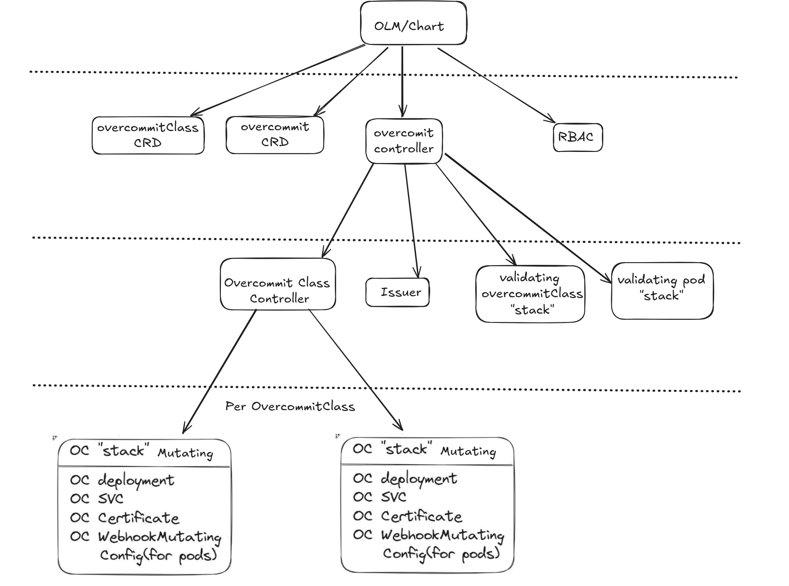
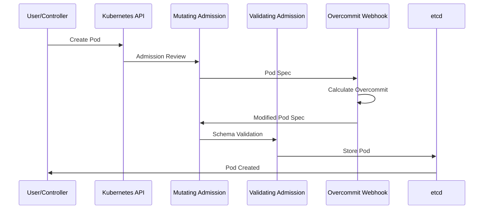
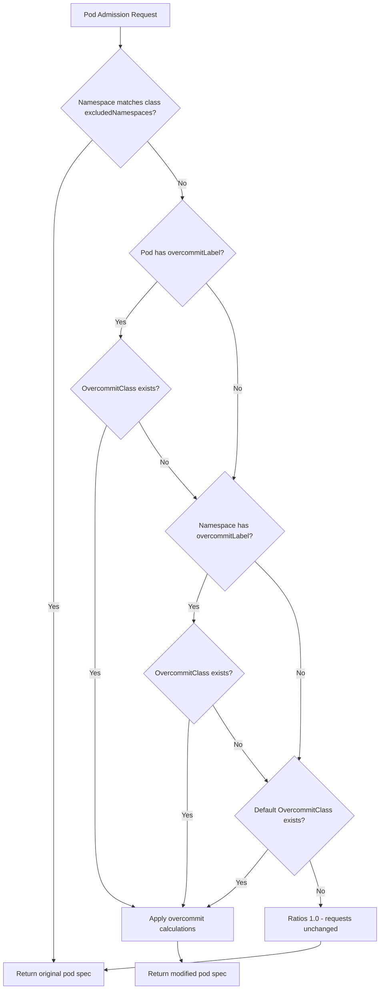
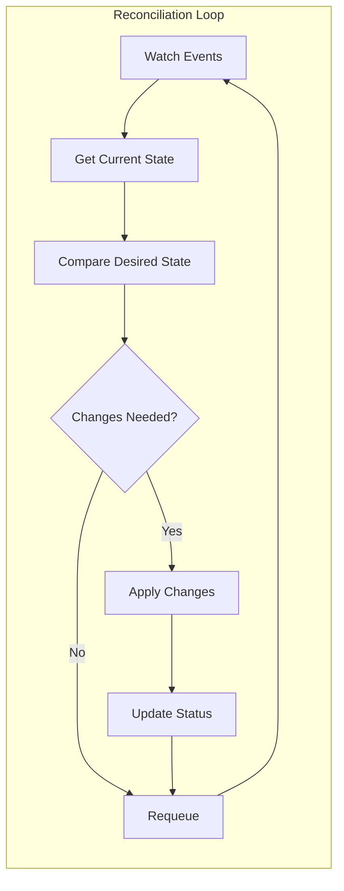

<!--
SPDX-FileCopyrightText: 2025 2025 INDUSTRIA DE DISEÑO TEXTIL S.A. (INDITEX S.A.)
SPDX-FileContributor: enriqueavi@inditex.com

SPDX-License-Identifier: CC-BY-4.0
-->

# 🏗️ Architecture Documentation

## 📋 Table of Contents

- [Overview](#-overview)
- [System Components](#-system-components)
- [Kubernetes API Flow](#-kubernetes-api-flow)
- [Custom Resources](#-custom-resources)
- [Admission Webhooks](#-admission-webhooks)
- [Controller Logic](#-controller-logic)
- [Resource Management](#-resource-management)
- [Security Model](#-security-model)
- [Monitoring and Observability](#-monitoring-and-observability)
- [Configuration Examples](#-configuration-examples)
- [References](#-references)

---

## 🎯 Overview

The **k8s-overcommit Operator** is a Kubernetes-native operator designed to intelligently manage resource overcommit on pod resource requests. It leverages the Kubernetes admission control mechanism to dynamically adjust CPU and memory requests based on configurable overcommit classes.

### 🎨 Design Principles

- **🔧 Declarative Configuration**: Uses Custom Resources to define overcommit policies
- **🏷️ Label-based Selection**: Applies policies based on pod and namespace labels
- **🛡️ Non-intrusive**: Modifies only resource requests, preserving limits
- **🔒 Secure by Default**: Excludes critical namespaces automatically
- **📊 Observable**: Provides metrics and logging for monitoring

---

## 🧩 System Components

### Core Components



### Component Descriptions

| Component | Purpose | Location |
|-----------|---------|----------|
| **Overcommit Controller** | Reconciles the `Overcommit` singleton and generates the operator's own resources (OvercommitClass controller deployment, pod validating webhook, issuer) | [`internal/controller/overcommit/`](../internal/controller/overcommit/) |
| **OvercommitClass Controller** | Watches `OvercommitClass` resources and generates one webhook deployment, service, certificate and `MutatingWebhookConfiguration` per class | [`internal/controller/overcommitclass/`](../internal/controller/overcommitclass/) |
| **Resource Generators** | Build the Kubernetes objects created by both controllers | [`internal/resources/`](../internal/resources/) |
| **Pod Mutating Webhook** | Mutates pod resource requests based on overcommit policies | [`internal/webhook/v1alphav1/mutating/pod_webhook.go`](../internal/webhook/v1alphav1/mutating/pod_webhook.go) |
| **Pod Validating Webhook** | Rejects pods that carry the `overcommitLabel` but reference a non-existent `OvercommitClass` | [`internal/webhook/v1alphav1/validating/pod_webhook.go`](../internal/webhook/v1alphav1/validating/pod_webhook.go) |
| **OvercommitClass Validating Webhook** | Validates `OvercommitClass` specifications | [`api/v1alphav1/overcommitclass_webhook.go`](../api/v1alphav1/overcommitclass_webhook.go) (rules in [`webhook_validations.go`](../api/v1alphav1/webhook_validations.go)) |
| **Certificate Manager** | Generates and manages TLS certificates for webhooks | [`internal/resources/generate_issuer.go`](../internal/resources/generate_issuer.go) |

> [!NOTE]
> The controller manager runs with `ENABLE_CONTROLLER=true`; the deployments generated for each
> class run the same binary with `ENABLE_CONTROLLER=false`, `ENABLE_POD_MUTATING_WEBHOOK=true` and
> `OVERCOMMIT_CLASS_NAME=<class>`, so every class gets its own webhook pod and TLS certificate.

---

## 🔄 Kubernetes API Flow

### Pod Creation Flow



### Webhook Decision Logic



The resolution order is **pod label → namespace label → default class**. Two details worth keeping in mind:

- `excludedNamespaces` is enforced by the generated `MutatingWebhookConfiguration` as a match
  condition on `object.metadata.namespace`; matching requests never reach the webhook.
- The mutating webhook's `failurePolicy` is `Fail`, so a class whose webhook pod cannot be reached
  blocks admission of the pods it selects (including its own namespace unless excluded).

Once a pod has been mutated, the annotation `overcommit.inditex.dev/applied=<class>` (together with
`overcommit.inditex.dev/cpu` and `overcommit.inditex.dev/memory`) is set so reinvocations do not
apply the ratios twice.

---

## 📦 Custom Resources

### Overcommit Resource

> [!IMPORTANT]
> **It's a singleton CRD**: only can exist one, and it has to be called **cluster**

The main configuration resource that enables the operator:

```yaml
apiVersion: overcommit.inditex.dev/v1alphav1
kind: Overcommit
metadata:
  name: cluster
spec:
  overcommitLabel: "inditex.com/overcommit-class"
  labels:
    environment: "production"
  annotations:
    description: "Main overcommit configuration"
```

**Key Fields** (`OvercommitSpec`):

- `overcommitLabel` (`string`, **required**, min length 1): Label key used to identify the overcommit class on pods/namespaces
- `labels` (`map[string]string`, optional): Labels applied to generated resources
- `annotations` (`map[string]string`, optional): Annotations applied to generated resources
- `nodeSelector` (`map[string]string`, optional): Node selector for the generated deployments
- `tolerations` (`[]corev1.Toleration`, optional): Tolerations for the generated deployments

**Status** (`OvercommitStatus`): `resources` (`[]ResourceStatus{name, ready}`) and `conditions`
(`[]metav1.Condition`, type `ResourcesReady`).

### OvercommitClass Resource

Defines overcommit policies for different workload types:

```yaml
apiVersion: overcommit.inditex.dev/v1alphav1
kind: OvercommitClass
metadata:
  name: high-density
spec:
  cpuOvercommit: 0.2
  memoryOvercommit: 0.8
  isDefault: true
  excludedNamespaces: ".*(^(openshift|k8s-overcommit|kube).*).*"
  labels:
    example: "label"
  annotations:
    description: "High-density workloads"
  nodeSelector:
    example.com/node-pool: system
  tolerations:
    - key: example.com/dedicated
      operator: Equal
      value: overcommit
      effect: NoSchedule
```

**Key Fields** (`OvercommitClassSpec`):

| Field | Type | Required | Validation / meaning |
|-------|------|----------|----------------------|
| `cpuOvercommit` | `float64` | yes | CRD range `0.0001–1`; webhook rejects `<= 0`, `> 1` and values with more than 4 decimals. CPU request = CPU limit × ratio |
| `memoryOvercommit` | `float64` | yes | Same validation as `cpuOvercommit`. Memory request = memory limit × ratio |
| `excludedNamespaces` | `string` | yes | Go regexp (max 512 characters) matched against the pod namespace; matching namespaces are never mutated |
| `isDefault` | `bool` | no (default `false`) | Class used when neither the pod nor the namespace carries a class. Only one class can be default (enforced by the validating webhook) |
| `labels` | `map[string]string` | no | Labels added to the resources generated for the class |
| `annotations` | `map[string]string` | no | Annotations added to the resources generated for the class |
| `nodeSelector` | `map[string]string` | no | Node selector for the class webhook deployment |
| `tolerations` | `[]corev1.Toleration` | no | Tolerations for the class webhook deployment |

A ratio of `1` leaves the corresponding request untouched. When no ratio can be resolved, the
operator uses `1.0` for both values, i.e. it does not modify the pod.

**Status** (`OvercommitClassStatus`): `resources` (`[]ResourceStatus{name, ready}` for the generated
deployment, service, certificate and webhook) and `conditions` (`[]metav1.Condition`, type
`ResourcesReady`).

`OvercommitClass` is cluster-scoped with short names `oc` and `ocs`; `kubectl get overcommitclass`
prints the `CPU`, `Memory` and `Default` columns.

---

## 🔗 Admission Webhooks

### Mutating Webhook Configuration

One `MutatingWebhookConfiguration` is generated per `OvercommitClass`, owned by the class
(see [`internal/resources/generate_resources_pod_mutating_webhooks.go`](../internal/resources/generate_resources_pod_mutating_webhooks.go)):

```yaml
apiVersion: admissionregistration.k8s.io/v1
kind: MutatingWebhookConfiguration
metadata:
  name: <class>-overcommit-webhook
  annotations:
    cert-manager.io/inject-ca-from: <operator-namespace>/<class>-webhook-certificate
webhooks:
- name: <class>-overcommit.inditex.dev
  clientConfig:
    service:
      name: <class>-webhook-service
      namespace: <operator-namespace>
      path: /mutate--v1-pod
  rules:
  - operations: ["CREATE"]
    apiGroups: [""]
    apiVersions: ["v1"]
    resources: ["pods"]
  - operations: ["UPDATE"]
    apiGroups: [""]
    apiVersions: ["v1"]
    resources: ["pods/resize"]
  failurePolicy: Fail
  sideEffects: None
  reinvocationPolicy: IfNeeded
  matchConditions:
  - name: exclude-namespaces
    expression: "!object.metadata.namespace.matches('<spec.excludedNamespaces>')"
  objectSelector:
    matchExpressions:
    - key: <spec.overcommitLabel>
      operator: In
      values: ["<class>"]
```

If `spec.isDefault` is `true`, a second webhook `default-<class>-overcommit.inditex.dev` is appended
to the same configuration; it selects pods where the label is **absent**
(`operator: DoesNotExist`) so the default class also applies to unlabelled workloads.

In addition, the `Overcommit` controller creates:

- A pod `ValidatingWebhookConfiguration` (`podvalidation.overcommit.inditex.dev`, path
  `/validate--v1-pod`, `failurePolicy: Fail`, `objectSelector` on the presence of `overcommitLabel`)
  that rejects pods carrying the label whose value does not match an existing `OvercommitClass`.
- `ValidatingWebhookConfiguration` for `overcommitclasses` (`overcommitclass.overcommit.inditex.dev`,
  path `/validate-overcommit-inditex-dev-v1alphav1-overcommitclass`).

### Webhook Logic Implementation

The pod mutation logic in [`pkg/overcommit/`](../pkg/overcommit/) follows this logic:

1. **Label Resolution**: Check pod → namespace → default class (`spec.isDefault: true`)
2. **Namespace Exclusion**: Enforced by the webhook match condition built from `spec.excludedNamespaces`
3. **Calculation**: Set `requests = limits × ratio` for CPU and memory of every container
   (and of init containers on create/update); limits are left untouched
4. **Idempotency**: Record the applied class in the `overcommit.inditex.dev/applied` annotation

The `OvercommitClass` validator ([`api/v1alphav1/overcommitclass_webhook.go`](../api/v1alphav1/overcommitclass_webhook.go))
checks on create/update: at most one default class, ratios in `(0, 1]` with at most 4 decimals, and a
valid `excludedNamespaces` regex.

---

## 🎮 Controller Logic

### Overcommit Controller

- **Overcommit Controller** ([`internal/controller/overcommit/`](../internal/controller/overcommit/)): reconciles
  the `Overcommit` singleton, sets itself as owner of every `OvercommitClass`, and creates the
  self-signed `Issuer`, the OvercommitClass validating webhook and the pod validating webhook.
- **OvercommitClass Controller** ([`internal/controller/overcommitclass/`](../internal/controller/overcommitclass/)):
  for each class, creates/updates its webhook `Deployment`, `Service`, `Certificate` and
  `MutatingWebhookConfiguration`, and reports them in `status.resources` / `status.conditions`.
- **Resource Cleanup**: generated objects are garbage-collected through owner references when the
  `OvercommitClass` or the `Overcommit` singleton is deleted.

### Reconciliation Loop



### Generated Resources

The operator generates several Kubernetes resources:

| Resource Type | Name (pattern) | Purpose | Generated By |
|---------------|----------------|---------|--------------|
| **Issuer** | `k8s-overcommit-issuer` | Self-signed issuer for webhook certificates | [`generate_issuer.go`](../internal/resources/generate_issuer.go) |
| **Deployment** | `k8s-overcommit-overcommitclass-controller` | Runs the OvercommitClass controller | [`generate_resources_overcommit_class_controller_controller.go`](../internal/resources/generate_resources_overcommit_class_controller_controller.go) |
| **Deployment** | `<class>-overcommit-webhook` | Runs the mutating webhook of one class | [`generate_resources_pod_mutating_webhooks.go`](../internal/resources/generate_resources_pod_mutating_webhooks.go) |
| **Service** | `<class>-webhook-service` | Exposes the class webhook on port 443 → 9443 | same file |
| **Certificate** | `<class>-webhook-certificate` (secret `<class>-webhook-secret`) | TLS certificate for the class webhook | same file |
| **MutatingWebhookConfiguration** | `<class>-overcommit-webhook` | Selects pods for the class | same file |
| **Deployment / Service / Certificate / ValidatingWebhookConfiguration** | pod validating webhook (`k8s-overcommit-pod-validating-webhook*`) | Rejects pods referencing a missing class | [`generate_resources_validating_webhooks.go`](../internal/resources/generate_resources_validating_webhooks.go) |
| **Deployment / Service / Certificate / ValidatingWebhookConfiguration** | OvercommitClass validating webhook | Validates `OvercommitClass` objects | [`generate_resources_validating_webhooks.go`](../internal/resources/generate_resources_validating_webhooks.go) |

The `nodeSelector` and `tolerations` of the `Overcommit` resource are applied to the deployments
generated for it, while those of an `OvercommitClass` are applied to that class' webhook deployment.

---

## 📊 Resource Management

### Overcommit Calculation

The core calculation logic is implemented in [`pkg/overcommit/make_overcommit.go`](../pkg/overcommit/make_overcommit.go).
For every container (and init container on create/update) that defines a CPU or memory limit:

```go
// Simplified excerpt of mutateContainers
if cpuLimit, ok := limits[corev1.ResourceCPU]; ok && cpuValue != 1 {
    newCPURequest := float64(cpuLimit.MilliValue()) * cpuValue
    requests[corev1.ResourceCPU] = *resource.NewMilliQuantity(int64(newCPURequest), resource.DecimalSI)
}

if memoryLimit, ok := limits[corev1.ResourceMemory]; ok && memoryValue != 1 {
    newMemoryRequest := float64(memoryLimit.Value()) * memoryValue
    requests[corev1.ResourceMemory] = *resource.NewQuantity(int64(newMemoryRequest), resource.BinarySI)
}
```

`cpuValue` / `memoryValue` come from the resolved `OvercommitClass` (`spec.cpuOvercommit`,
`spec.memoryOvercommit`). A ratio of `1` leaves the request untouched; a pod is never given a
request when the limit is absent. `pods/resize` sub-resource updates are handled separately
(`OvercommitOnResize`) and only touch regular containers.

### Resource Validation

- **Range Validation**: Overcommit ratios must be in the `(0, 1]` range with at most 4 decimals
  (CRD minimum `0.0001`, maximum `1`, plus the validating webhook)
- **Resource Presence**: Only containers with CPU/memory limits are modified
- **Namespace Exclusion**: Regex (`excludedNamespaces`) matched against the pod namespace

---

## 🔒 Security Model

### RBAC Permissions

The controller ClusterRole is defined in `config/rbac/role.yaml` (generated from kubebuilder markers). The Helm chart uses the same explicit rules, plus `namespaces` get/list/watch for label lookups, and keeps the binding to the built-in `view` ClusterRole for owner resolution.

### Certificate Management

- **cert-manager Integration**: Automatic TLS certificate generation
- **Self-signed Issuer**: Uses self-signed certificates for internal communication
- **Automatic Rotation**: Certificates are automatically renewed

### Namespace Isolation

- **Critical Namespace Protection**: Excludes system namespaces by default
- **Configurable Exclusions**: Regex-based exclusion patterns
- **Fail-safe Design**: Defaults to no modification if configuration is invalid

---

## 📈 Monitoring and Observability

### Metrics

The operator exposes Prometheus metrics on port 8080. The names are prefixed with
`k8s_overcommit_operator_`; see [metrics.md](./metrics.md) for the full list, for example:

- `k8s_overcommit_operator_pods_requested_total{class}`: Pods submitted to the webhook per class
- `k8s_overcommit_operator_mutated_pods_total{class}`: Pods mutated per class
- `k8s_overcommit_operator_total_classes`: Number of `OvercommitClass` resources
- `k8s_overcommit_operator_version`: Operator version

### Logging

Structured logging with configurable levels:

```bash
# Enable debug logging
make run ARGS="--zap-log-level=debug"
```

### Health Checks

- **Readiness Probe**: Webhook endpoint health
- **Liveness Probe**: Controller manager health
- **Metrics Endpoint**: Prometheus scraping endpoint

---

## 🔧 Configuration Examples

### Development Environment

```yaml
apiVersion: overcommit.inditex.dev/v1alphav1
kind: OvercommitClass
metadata:
  name: development
spec:
  cpuOvercommit: 0.1     # Very conservative
  memoryOvercommit: 0.9  # Allow high memory usage
  isDefault: true
  excludedNamespaces: ".*(kube|openshift).*"
  nodeSelector:
    example.com/env: development
```

### Production Environment

```yaml
apiVersion: overcommit.inditex.dev/v1alphav1
kind: OvercommitClass
metadata:
  name: production
spec:
  cpuOvercommit: 0.5     # Balanced approach
  memoryOvercommit: 0.8  # Conservative memory
  isDefault: true
  excludedNamespaces: ".*(kube|openshift|istio|monitoring).*"
```

---

## 📚 References

- [Kubernetes Admission Controllers](https://kubernetes.io/docs/reference/access-authn-authz/admission-controllers/)
- [Operator Pattern](https://kubernetes.io/docs/concepts/extend-kubernetes/operator/)
- [Custom Resource Definitions](https://kubernetes.io/docs/concepts/extend-kubernetes/api-extension/custom-resources/)
- [cert-manager Documentation](https://cert-manager.io/docs/)
- [Operator SDK](https://sdk.operatorframework.io/docs/)

---

<div align="center">

**[⬆️ Back to Top](#-architecture-documentation)**

</div>
